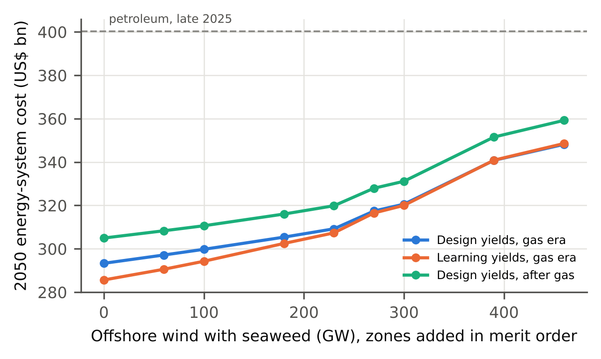
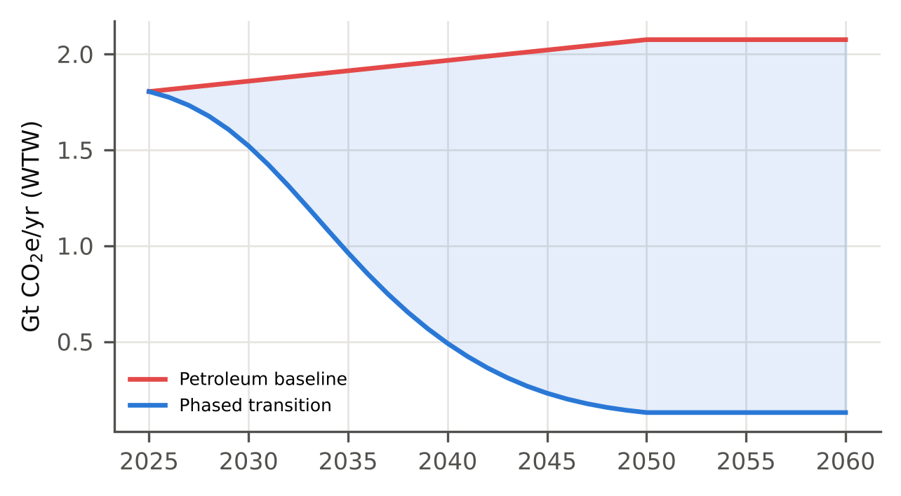
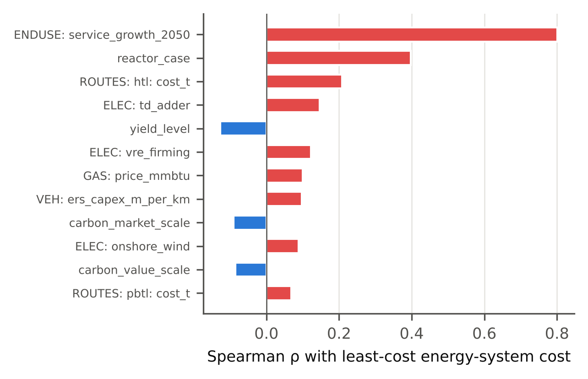
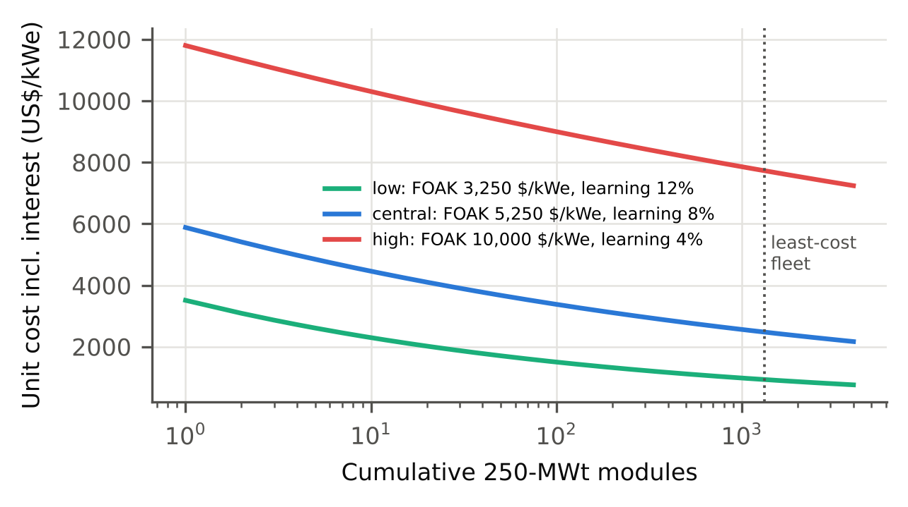
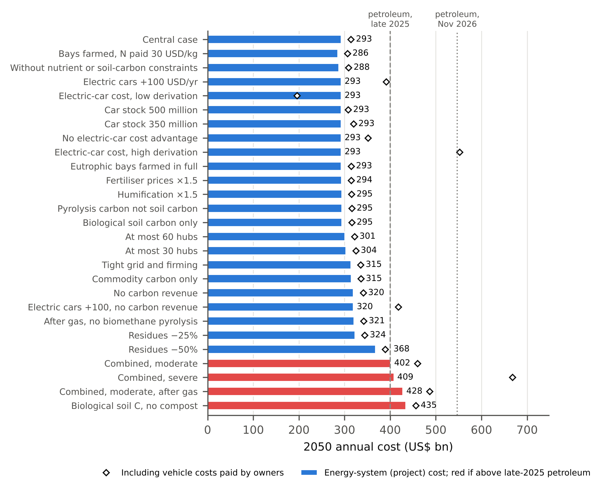
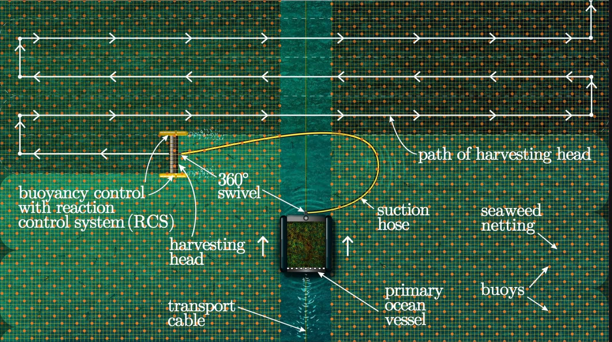
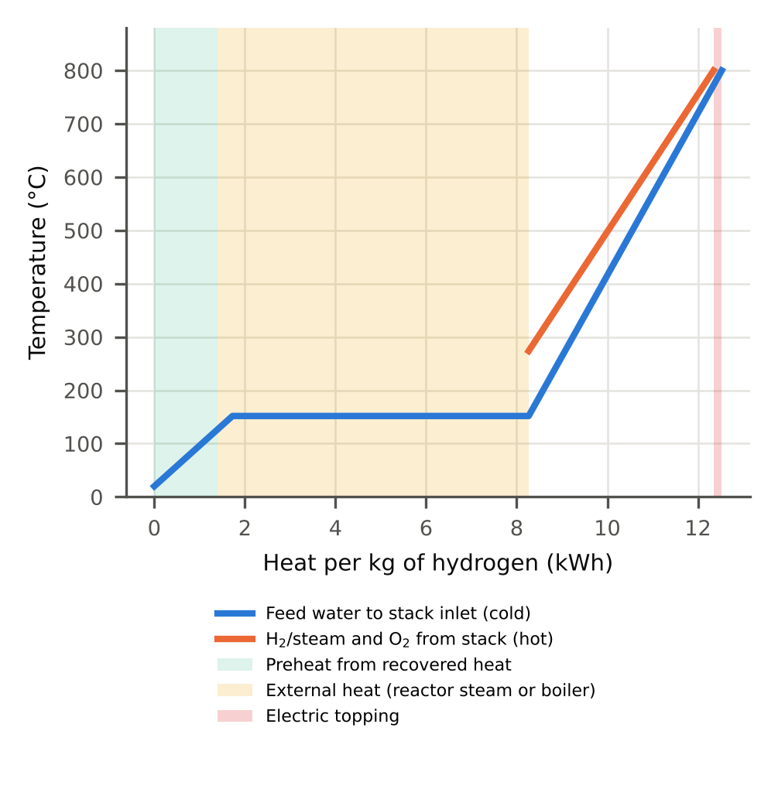

Model version CN v1.6.3 (23 November 2026). All tables in this document are generated from the model inputs and outputs by `cn_sm_tables.py`; numbers in the text are read from `cn_manuscript_numbers.json`.

**Contents.** Supplementary text S1 to S19; figures S1 to S7; tables S1 to S27.

# Supplementary text

## S1. Scope, study area and system boundary

The model represents one annual energy balance for 2050 for mainland China, including the Guangxi Zhuang, Inner Mongolia, Ningxia Hui, Xizang (Tibet) and Xinjiang Uyghur autonomous regions, and the Hong Kong and Macau Special Administrative Regions. Hong Kong imports electricity from the Daya Bay nuclear plant and Guangdong, and Macau imports most of its electricity from Guangdong; both draw refined fuels from regional refineries, so they are modelled inside the mainland system. Taiwan has a separate grid, refineries and fuel market and is modelled as an island system with its own demand, resources and costs (S14). Transport scope matches the United States model v8.4: road (cars, two- and three-wheelers within gasoline demand, trucks and buses including LNG and CNG vehicles), aviation including international departures, rail, domestic shipping and fishing vessels, bonded international bunkers, farm machinery, construction and mining machinery, industrial trucks and pipeline compression. Costs are annualised 2050 costs in 2026 US dollars at a 5% real discount rate, pre-tax, and transport-only: food, nutrient and livestock outcomes are reported separately and not credited. Unlike the United States model, low-grade heat sold to food uses earns nothing inside the transport boundary; its gross value at USD 8 per MWh is reported separately, and a sensitivity case restores the credit.

## S2. Baseline demand and 2050 technology shares

Table S1 lists the 2025 baseline. China's 2025 consumption of gasoline (155 Mt), diesel (203 Mt) and kerosene and jet fuel (40.21 Mt) follows the China Association of Petroleum Enterprises' 2025 review, reported by SunSirs; transport natural gas (42.6 bcm) is derived from ICIS's 2026 estimate of 44.14 bcm and its 3.5% growth. The split of diesel between segments is an assumption: on-road 120 Mt, rail 3.5 Mt, marine 12 Mt, farm 25 Mt, construction and mining 25 Mt, industrial trucks 3 Mt and non-transport uses 14.5 Mt (excluded). Hong Kong jet fuel (5.6 Mt) is consistent with imports of 3.4 million kilolitres in the first half of 2024; Hong Kong gasoline, diesel and bunkers and all Macau quantities are assumptions. Taiwan uses EIA 2024 consumption (gasoline 188 kb/d, diesel 116 kb/d with 60% assumed on-road, jet 68.8 kb/d). Energy contents are net calorific values between the GB/T 2589-2020 and IPCC 2006 defaults (gasoline 12.06, diesel 11.89, jet 12.00 kWh/kg, i.e. 43.4, 42.8 and 43.2 GJ/t; fuel oil 11.22 kWh/kg, the IPCC value; gas 9.9 kWh/m^3^, with gas priced per MMBtu on the matching higher heating value, 37.5 million MMBtu per bcm). Service demand in 2050 is 1.15 times 2025 in the central case.

Technology shares (table S2) reflect China's trajectory: new-energy vehicles were 49% of 2025 car registrations and zero-emission vehicles 25% of medium and heavy truck sales. Heavy-truck drivetrain ratios use 2.40 kWh per mile (battery-electric tractor) and 21.1 MJ per mile (diesel tractor at about 6.9 mpg, 144.9 MJ per gallon). The 144.9 MJ per gallon is the EIA heat content, a higher heating value; the model's diesel demand is on a lower-heating-value basis (42.8 GJ per t), so the diesel energy is converted with the per-gallon LHV/HHV ratio of 0.935 (128,450/137,381 Btu) to 19.7 MJ per mile, giving 2.40 × 3.6 / 19.7 = 0.44 kWh of electricity per kWh of displaced diesel; for fuel-cell trucks 4.44 kWh of hydrogen (LHV) per mile gives 0.81. For a Chinese 49-t tractor using 32 L of diesel per 100 km this is 1.4 kWh per km and 7.7 kg of hydrogen per 100 km. CN v1.6.1 and earlier used 0.41 and 0.76, mixing the two bases (corrected in v1.6.2). The United States model v8.4 divided the same numbers without the factor 3.6 (S15); because its demand is in EIA quads, a higher-heating-value basis, its corrected ratios remain 0.41 and 0.76.

Table S2b derives the net annual ownership cost of a battery-electric car relative to a comparable petrol car in 2050, excluding energy. The purchase-price difference is annualised over 12 years at the 5% discount rate. Expected battery replacement assumes a 55 kWh pack replaced at year 9 with the stated probability. Maintenance and repair for a petrol car is taken as USD 350 per year and the electric saving as 15 to 45%. The insurance penalty ranges from USD 40 to 300 per year; the 2025 average new-energy car premium was about USD 610, with like-for-like premiums about 20% above petrol cars. The central value is -93 USD per year; the low and high values set the Monte Carlo triangle. The car stock (420 million in 2050) is tested at 350 and 500 million.

## S3. Decision variables, objective and constraints

Decision variables (all non-negative): onshore wind in two cost tiers, solar, concentrated solar, light-water reactors, offshore wind by zone, surplus electricity exported to the wider grid, imported renewable liquids (Taiwan only), number of reactor hubs, top-tier heat to the turbine, hydrogen from pyrolysis, alkaline electrolysis, steam electrolysis and sulfur–iodine, ten residue tiers, new bamboo, hemp area, liquefaction and gasification–synthesis throughput, cellulosic ethanol, eight starch and sugar ethanol feedstocks, alcohol-to-jet, direct ethanol, four oil feedstocks and hemp oil to hydroprocessing, electric heat and drying, heat sold to food uses, optional heat-exchanger transfers between tiers, seaweed to liquefaction or gasification by zone, and carbon sold to eight markets. The objective is

$$\min C = \sum_i c_i x_i + F,$$

with $F$ the costs fixed by the end-use mix (grids, charging, electric expressways, rail electrification, vehicles and machines, hydrogen delivery to vehicles, residual pipeline gas). The energy-system (project) cost is the total less the vehicles-and-machines term, which owners pay; the LP solution is the same either way, because that term is fixed by the end-use mix. Constraints: electricity supply ≥ transport demand plus process loads; solar ≤ 40% of supply; firm supply (light-water reactors, concentrated solar with storage and hub electricity) ≥ 15% of transport electricity; top-tier, process-steam and drying heat used ≤ heat available from hubs (plus electric heat); hydrogen made ≥ hydrogen used; liquids ≥ liquid demand; jet-range liquids ≥ jet demand; ethanol made = ethanol used; residue pool used = residues + bamboo + hemp stalks + sorghum bagasse; seaweed tied to the wind area of each zone; heat sold ≤ hub low-grade heat and ≤ the food market; carbon sold = carbon made. A reconciliation check confirms that the reported cost equals the LP objective plus fixed terms to 10^-6^ billion dollars in every case.

## S4. Power and reactor parameters

Table S3 gives power and hydrogen parameters, table S4a reactor cost cases. The hub has six 250 MWt modules (1,500 MWt), 93% capacity factor, 60-year life, USD 30 per kWt-year fixed operation and USD 9 per MWh of heat fuel. Heat tiers: 30% at the top tier (750°C helium for methane preheat), 7.5% as process steam (biocrude upgrading and steam raising for electrolysis) and 10% for drying, each withdrawn with a turbine penalty (0.30 and 0.15 MWh of electricity per MWh), the rest to a 40%-efficient turbine, 35% of whose rejected heat is usable at 35–70°C. Fleet cost follows Wright's law per module. Because the cost curve makes total cost non-convex in hub count, the reported cases are solved at every integer number of hubs from 0 to 1,500 at the matching fleet-average cost; none of the optima lies at the bound. Monte Carlo draws use every 25th hub count, refined to single hubs around the best. The central fleet-average cost, including interest during construction, is USD 2,815 per kWe for the least-cost fleet of 1,326 modules (fig. S4).

## S5. Reactor technology alternatives

Table S4b lists the five hub technologies and their 2050 transport costs. The HTR-PM is in commercial operation at Shidaowan (two 250 MWt modules, 210 MWe) [S1]. TMSR-LF1 is a 2 MWt experimental thorium molten-salt reactor at Wuwei, Gansu, which loaded thorium in October 2024 and reported thorium-to-uranium conversion in November 2025 with a conversion ratio of about 0.1 [S2]. The CFR-600 sodium-cooled fast reactor at Xiapu, Fujian, began low-power operation in 2023 with highly enriched uranium fuel [S3]. The ACP100 (Linglong One) light-water SMR at Changjiang, Hainan, completed its non-nuclear turbine test in December 2025 [S4]. The 950°C reactor is a future concept. Outlet temperature sets the methane preheat the reactor can supply, $q = c_p (T - 75) m_{\mathrm{CH_4}} / 3600$ kWh per kg H~2~ with $c_p$ = 3.3 kJ/kg·K and 4.08 kg of methane per kg of hydrogen, capped at the full 8.3 kWh per kg; the balance is supplied by electric heaters at 95% efficiency. Efficiencies, cost multipliers and fuel costs are assumptions and are the main reason for the ranking.

## S6. Land biomass and regional crops

Tables S5 and S6 give the residue tiers, the autonomous-region crops, oil feedstocks, bamboo and hemp limits and their use in the least-cost case. Straw caps reflect China's ~860 Mt annual straw production and agronomic removal limits of 45% for rice, 19% for wheat and 42% for maize [S5], net of feed, mushroom substrate and existing uses. These limits are intended to protect soil organic carbon and limit erosion. The nutrients and stable soil carbon removed with the biomass must be returned (section S17). The model does not represent effects on soil structure, moisture and erosion beyond the removal limit, nor collection radii, which enter only through the tier prices. Residue supply is therefore tested at 75% and 50% of the caps (table S15), and soil-carbon losses of 20 and 40 g CO~2~e per MJ of residue-derived fuel beyond the modelled balance are added as a boundary sensitivity (table S12). Guangxi: cassava ethanol (Guangxi grows more than 60% of China's cassava), molasses from about 6.4 Mt of cane sugar per season, surplus bagasse and cassava residues, jatropha on hill slopes (40% of jatropha oil assigned to Guangxi, the rest to Yunnan, Sichuan and Guizhou) and clumping bamboo. Inner Mongolia: maize stover and crop stalks, sweet sorghum on saline–alkaline land (4,500 L of ethanol and 8 t of bagasse per hectare), Jerusalem artichoke on sandy land and hemp in the east. Xinjiang: cotton stalks, drip-irrigated sweet sorghum and cottonseed and non-edible oilseed residues. Ningxia: Loess Plateau crop residues, sweet sorghum and sweet potato. Xizang: alpine grassland and forestry residues only (1.5 Mt at USD 75 per tonne), reflecting its short growing season; yak-dung biogas is counted in the gas balance. Conversion routes, yields and hydrogen needs are those of the United States model; Chinese capital costs are lower (liquefaction USD 130 per tonne, gasification–synthesis USD 230 per tonne).

## S7. Offshore wind, seaweed and the Grid Harvester

Table S7 gives the nine zones. Yields at three levels (demonstrated, design, learning) are per hectare of farmed area between turbines, which is a fraction of the wind-farm area. Chinese nearshore kelp farms reach far higher yields per hectare of farm, but offshore yields between turbines are not demonstrated. Logistics use the Grid Harvester (fig. S6), a solar-powered harvesting head that cuts and pumps seaweed between the long-lines, battery and wing-sail haul vessels and inspection drones with Chinese capital costs. Seaweed fuel costs USD 180–260 per MWh of liquid (table S7; fig. S1). Seaweed nutrients are not credited at fertiliser prices; they enter the nutrient balance instead (section S17), so they are not counted twice. The same Grid Harvesters, vessels and drones harvest the nearshore farms in eutrophic bays (section S17, table S24); the Grid Harvester fleet in each solution is sized for offshore and nearshore areas together. The Grid Harvester drawings (fig. S6) are the authors' own, prepared for their related United States model; no third-party material is reproduced.

## S8. Carbon markets, emissions and petroleum comparator

Pyrolysis carbon (3 kg per kg of hydrogen) is sold in eight capped markets: vehicle structures and hydrogen tanks (1.5 Mt at USD 3,500 per tonne), battery anode graphite (4 Mt at USD 2,500), carbon black (7 Mt at USD 800), specialty carbon, metallurgical carbon, construction additives, soil amendment (unpaid, up to 100 Mt; it counts toward the soil-carbon balance at 90% stability) and permanent storage (USD –20 per tonne). Emission intensities follow the U.S. model: petroleum well-to-wheel 89–96 g CO~2~e/MJ, gas 70 g/MJ, liquids by route 6–40 g/MJ, electricity 10 g/kWh life-cycle, pyrolysis hydrogen with 1.5% upstream leakage and 2% hydrogen leakage at a hydrogen GWP of 11.6. Table S8 gives the pre-tax prices. Retail gasoline and diesel caps are converted by dividing by 1.13 (value-added tax) and subtracting the consumption tax (1.52 yuan/L gasoline, 1.20 yuan/L diesel) at exchange rates of 7.08 yuan per dollar (25 November 2025) and 6.71 (18 November 2026). Jet fuel is priced ex-refinery net of value-added tax; bunker fuel at Singapore-type VLSFO prices; road gas at USD 11 and 14 per MMBtu. The petroleum comparator applies the same service growth as the system.

The carbon values assume that pyrolysis carbon can be purified, graphitised or otherwise qualified for each market; purification, graphitisation, quality control and certification costs are included only through the assumed net values. The stress cases remove that revenue (all carbon to paid permanent storage) or keep only the commodity markets (carbon black, metallurgy, construction, soil, storage). Table S13 shows where the carbon goes and how long it would stay out of the atmosphere: none of the least-cost carbon goes to long-term storage, and none is counted as an emission reduction. Table S12 recomputes least-cost emissions with wider life-cycle boundaries; these parameters do not enter the cost, so the solution is not re-optimised.

Steam electrolysis heat. `cn_htse_heat.py` computes a temperature–enthalpy balance per kg of hydrogen (table S16, fig. S7). Feed water at 20°C is preheated, evaporated at 0.5 MPa (152°C) and superheated to the 800°C stack inlet; 11.2 kg of steam is fed for 80% utilisation. The cathode (hydrogen and unconverted steam) and anode (oxygen, no sweep gas) streams leave at 800°C. A counterflow high-temperature recuperator superheats the steam to 775°C (25 K minimum approach, checked along the exchanger), cooling the hot streams to 274°C; their remaining sensible heat preheats feed water to 127°C, and condensation of 90% of the unconverted steam below its 100°C dew point preheats feed water to 75°C. The external heat is then 6.87 kWh per kg, all needed at or below 152°C, close to the 6.4 kWh per kg of the Idaho National Laboratory reference design; without the low-temperature recovery it would be 8.26 kWh per kg. Electric topping is 0.68 kWh per kg: 0.18 kWh for the final 25 K and 0.50 kWh of stack and hot-box heat loss (1.5% of stack electricity). Gas enthalpies use NIST Shomate equations (ideal gas) and water properties steam-table values at 0.5 MPa. The recuperator needs 1.1 m² per kg per hour of hydrogen capacity (overall coefficient 60 W/m²K, mean temperature difference 61 K), which at USD 3,000 per m² installed adds USD 0.03 per kg to the capital charge. Because the high-temperature duty is met by recuperation, the reactor (or boiler) only has to raise steam, which the HTR-PM's process steam can do with a large margin; the same topping applies with and without reactor steam. Sensitivity cases with 3 kWh per kg of topping and with no low-temperature recovery are in table S15. This is a flowsheet-level balance; stack degradation, pressure drop, start-up heating and part-load operation are not modelled.

## S9. Natural-gas supply

`cn_gas.py` balances China's gas demand year by year (table S9). Domestic remaining technically recoverable resources are 40 tcm conventional and tight, 25 tcm shale and 11 tcm coalbed methane, less 3.2 tcm already produced, times a recovery factor (central 0.6). Domestic production capacity grows 3% a year from 261.9 bcm to a 360 bcm plateau, subject to a 15-year reserves-to-production floor. Pipeline imports rise from 81 bcm (2025) to 114 bcm (2030) and 150 bcm (2035), drawn from a 20 tcm pool of exporter gas with the same floor. Liquefied natural gas imports are capped at 140 bcm. Non-transport demand grows 1.5% a year to 2040; road gas and compressor gas phase down with electrification; the pyrolysis programme ramps from 2030 to 48 bcm in 2050. Heat pumps replace 90% of space and water heating gas by 2050 (COP 3), and biomethane reaches 30 bcm (central) or 80 bcm (high) by 2045. First shortfall: 2141 (central), 2144 without the programme, and 2100–2175 across sensitivities; peak import share 37%. The 81-case grid over recovery, LNG ceiling and pipeline pool is in `cn_gas_depletion.json`.

## S10. After gas, closed fuel cycles and fissile accounting

After gas, no fossil gas is used: pyrolysis may run only on biomethane from the digesters (section S17), pipeline compressors are fully electric and the vehicle lightweighting credit from pyrolysis carbon is not taken; the rest of the hydrogen comes from steam electrolysis using, per kg, 36.8 kWh~e~ for the stack and balance of plant, 6.87 kWh~th~ of external steam-raising heat and 0.68 kWh~e~ of electric topping (section S8), or from the sulfur–iodine cycle for 950°C reactors. The closed-cycle cases assume breeding thorium molten-salt or sodium fast hubs that fission 0.95 MWd per gram of heavy metal with 2% recycling loss. Fuel accounting is at inventory level only: once-through HTR-PM fuel at 8.5% enrichment and 90 GWd/t; closed-cycle heavy metal per year; start-up fissile inventory of 10 t plutonium per GWe for fast reactors and 1.5 t fissile per GWe for thermal molten-salt reactors (assumptions). Pools: plutonium in China's spent fuel (about 11,000 tHM discharged by end-2024 and a projected 111,290 tHM by 2050 at about 1% plutonium [S6, S7]) and the IPFM estimate of military plutonium (2.9 ± 0.6 t) [S8]. These pools are not separated or qualified fuel, and no fuel-cycle process is modelled. For the closed thorium fleet: 254 GWe, 231 t of heavy metal a year, 380 t of start-up fissile material (about 82,000 t of natural uranium if supplied as 19.75% enriched uranium), and about 430 years of China's identified thorium (100,000 t) at the annual rate.

## S11. Regional screen

`cn_regions.py` splits mainland demand, emissions and costs with fixed regional shares (road, air, farm and mining shares in `cn_inputs.REGIONS`, from 2024 GDP, sown area, mining and airport traffic) and assigns least-cost feedstock use to regions by the location of each resource. Regional renewable potentials are order-of-magnitude values for comparison only. This is a reporting split, not a regional optimisation; transmission and inter-regional fuel trade are implied, not costed.

## S12. Heat cascade, food and cross-feeding

Low-grade heat first heats Asparagopsis tanks, then greenhouses (220 kWh per m^2^, 40 kg per m^2^, market up to 30 Mt of vegetables), then recirculating fish and shrimp farms (4 kWh per kg, market up to 5 Mt, 40% shrimp). Drying heat dries 0.5 Mt of food seaweed and up to 80 Mt of grain near hubs. `cn_crossfeed.py` balances feed flows with the coefficients in the script: fish and shrimp feed conversion ratios of 1.4 and 1.3; fishmeal inclusion of 10% and 20%; processing by-products of 45% (fish) and 40% (shrimp) yielding 21% fishmeal and 25% shrimp meal; insect meal at 3% of wet greenhouse waste (15% of output); hemp meal up to 12% and Ulva up to 5% of fish feed; 30% nitrogen retention, 50% of the remainder dissolved and 60% recovered by Ulva at 3.5% nitrogen; abalone eating 2.4 kg and sea cucumber 1.5 kg of dry algae per kg of growth, with 0.3 Mt of each and 0.3 Mt of feed kelp from the existing industry. Results: 51% of marine protein and 23% of feed protein met internally; 78 kt nitrogen recovered.

## S13. Conditional Monte Carlo, sensitivity and stress tests

Table S10 lists the 34 uncertain parameters. Each case uses 1,000 draws with fixed seeds (11 least cost, 13 offshore, 17 after gas). Spearman rank correlations with least-cost system cost are shown in fig. S3. Break-even multiples and the share of draws cheaper than petroleum at multiples 0.5–2.0 are in `cn_breakeven.json` and `cn_breakeven.csv`. Parameters are drawn independently, so the share of draws cheaper than petroleum is a conditional sensitivity result, not a probability. Correlated adverse outcomes are represented by the deterministic stress cases in table S15 and fig. S5, each re-optimised with the bounded exhaustive hub search; results are in `cn_robustness.json`.

## S14. Taiwan island system

Taiwan's LP uses its own demand (table S1 note), onshore wind (15 TWh cap), solar (60 TWh), a 25 GW Taiwan Strait offshore zone, 2.5 Mt of residues, 0.05 Mha of bamboo and 0.1 Mt of used cooking oil, liquefied natural gas at USD 12 per MMBtu delivered, a 1.4 times reactor-cost multiplier for a small first fleet, and imported renewable liquids at USD 170 per MWh. Cases: least cost (nuclear hubs and light-water reactors allowed), no nuclear (with batteries replacing firm supply at a USD 35 per MWh firming charge), after gas, and with the 25 GW offshore zone forced. Taiwan's nuclear policy is a matter for Taiwan; the model reports both cases.

## S15. Cross-check of the United States model v8.4

`cn_us_crosscheck.py` reruns the United States least-cost and post-gas cases with corrected heavy-truck ratios (0.41 and 0.76 instead of 0.114 and 0.210). U.S. transport electricity rises from 1,377 to 1,837 TWh, least-cost cost from USD 455.2 to 521.4 billion, and the saving against late-2025 petroleum falls from 23.2% to 12.0%; after gas, from 16.4% to 4.7%. Emission reductions are almost unchanged (93.8% to 93.4%). In the China model, the uncorrected ratios would raise the least-cost saving to 37.2%. The United States v8.4 code also disables steam electrolysis before gas runs out. Re-solving the United States least-cost case with it enabled gives the same result (pyrolysis remains cheaper at United States gas prices), so the restriction does not affect the submitted United States numbers. In this China model steam electrolysis is available in both eras; with the v8.4 restriction and otherwise identical inputs, the China least-cost case would cost USD 314.7 billion instead of 314.1 billion and use 94 bcm of gas for 16.5 Mt of pyrolysis hydrogen. The source files of the United States v8.4 model used for this cross-check are included unchanged (us2_model.py, us2_inputs.py, grid_harvester.py), and `cn_us_crosscheck.py` verifies their SHA-256 hashes before running.

## S16. Build-rate, system-structure and wind-lull screens

Table S14 reports the reactor modules, heat capacity and wind capacity that each solution needs per year, and the shares of firm and variable electricity. Modules are assumed to be built from 2032 to 2050 and wind from 2026 to 2050. For comparison, China approved at least ten large reactors a year from 2022 to 2025 (about 12 GWe, or about 32 GWt) and added about 120 GW of wind in 2025. The screen does not test hourly adequacy, ramping, storage, transmission or stability. Controllable loads (steam electrolysis, drying, managed charging and hydrogen storage) are large in the solutions and would support balancing, but an hourly dispatch and network study is required to show that the annual solution is operable.

Table S17 reports a stylised wind-lull screen. During a windless, overcast winter week (7 days; onshore wind at 8%, offshore wind at 10%, solar at 8% and concentrated solar at 30% of capacity), all flexible loads stop (electrolysis, electric process heat and fuel-conversion plants, whose products are stored) and hub heat goes entirely to the turbines (40% efficiency, 93% availability). The inflexible load is direct transport electricity at 115% of its annual average. Any shortfall is covered by hydrogen-fired backup (USD 750 per kW, 25 years, 40% efficient) burning hydrogen valued at USD 2 per kg for two such weeks a year. Hub turbine-generators are assumed able to take the full reactor heat, as in the HTR-PM demonstration plant, whose two 250 MWt reactors drive a single 210 MWe turbine; providing that capacity, and switching heat from process use to the turbines within hours, has to be demonstrated. Table S18 repeats the screen with no wind, with reactor availability of 80%, with turbines sized for 60% of reactor heat and for a 14-day lull. The backup costs are lower bounds: hydrogen storage (caverns or tanks), the extra electrolyser capacity needed to replace hydrogen not produced during lulls, and delivery of hydrogen to the backup plants are not priced. The screen distinguishes annual resource adequacy from operational feasibility: it says nothing about ramping, reserves, inertia, network congestion or the daily shape of charging, and its parameters are assumptions.

The lull cost in table S17 is a lower bound: backup plant and the hydrogen it burns. Tables S26 and S27 bracket it. A plausible estimate adds a 15% reserve margin on the backup plant, hydrogen storage (USD 25 per kg of working capacity, typical of salt caverns or lined rock) for one lull's backup fuel plus the vehicles' hydrogen use during the lull, extra hydrogen-production capacity to make up the output lost while electrolysers stop, and USD 150 per kW to deliver backup power. A high estimate assumes a 14-day lull with no wind, a 20% reserve margin, storage at USD 100 per kg (where salt caverns are unavailable) and USD 300 per kW of transmission. Neither is a reliability study: frequency of lulls, correlated outages, ramping, reserves and network constraints need an hourly model.

## S17. Nutrient and soil-carbon balance, biological soil-carbon options and nearshore bioextraction

For each of N, P and K the LP adds the row: removed in residues, bamboo, hemp stalk and bagasse ≤ returned by hydrochar, digestate, gasifier ash, ethanol stillage, offshore and nearshore seaweed + mineral fertiliser bought − recovered nutrients sold. Removal uses the contents in table S20 [S9]; all nutrient quantities are elemental, and mineral fertiliser is priced per tonne of element (USD 700 per t N, 2,600 per t P and 1,000 per t K; P = 0.436 P~2~O~5~ and K = 0.830 K~2~O, so these are about USD 1,130 per t P~2~O~5~ and 830 per t K~2~O); for each conversion route the returned amount is the feed tonnage times the cap-weighted nutrient content of the land-biomass pool times the partition and recovery shares in table S21 [S10]. Each return is a separate variable bounded by the feed that produces it, so the LP may also leave a stream unreturned. Return costs per t of feed are USD 6 for hydrochar, USD 12 for anaerobic digestion of the aqueous phase (including ammonia stripping and struvite recovery), USD 1 for ash and USD 4 for stillage; seaweed sent to soil costs USD 70 per t dry for washing, drying and spreading on top of its farm cost.

Digestion of the liquefaction aqueous phase yields 0.35 MWh of methane per t of feed [S11], with 1% of the methane lost. The biomethane can be sold at the gas price or fed to pyrolysis, where it displaces fossil gas. After gas, pyrolysis is allowed only on biomethane, so its carbon is biogenic in origin; a stress case forbids pyrolysis after gas altogether (table S15). Methane quantities are on the same higher-heating-value basis as the gas price.

The soil-carbon row requires that stable carbon returned (hydrochar 0.12 t per t of feed at 60% carbon, half stable; digestate carbon after digestion, 30% humified; seaweed 300 kg C per t dry, 10% humified; pyrolysis carbon 90% stable) is at least the residue carbon times the humification coefficients of table S20. A second row requires that the biogenic sources supply at least half of the requirement, because inert carbon alone does not sustain soil organisms. If no feasible solution meets both rows (for example without reactors, hence without pyrolysis carbon, or with half the residue supply), the LP is re-solved with a gap variable priced at USD 500 per t of carbon that lowers both requirements; the gap is counted as 44/12 t CO~2~ per t of carbon. The gap is an accounting entry, not material returned to soil, and it does not show that soil fertility is maintained. With the biological options available, no reported case uses it. The bounded hub search prefers any hub count that closes the balance over one that needs the gap. Tables S22 and S23 report the balances; table S15 the cost of each variation.

Two biological options can supply soil carbon and nutrients in every case (table S25). Winter legume green manure, such as Chinese milk vetch, can be grown on paddy and other fields now left fallow in winter: about 9.3 Mha of winter fields in southern China are underused, 72% of them readily available [S16], so the cap is 6.7 Mha. It adds 0.29 t of stable carbon and 60 kg of fixed nitrogen per ha at USD 200 per ha. Compost can be made from livestock manure that is not now returned to fields: China produces about 3.8 billion t of manure a year, with reported utilisation rates from under 60% [S17] to 78% [S18]; the cap of 50 Mt of compost dry matter is about half of what the unused share could yield even at the higher rate. Compost adds 0.105 t of stable carbon and 15, 6 and 12 kg of N, P and K per t of dry matter at USD 60 per t, with composting emissions of 0.1 t CO~2~e per t. A separate case replaces soil carbon from biological sources only: pyrolysis carbon is not counted, the whole requirement must be biogenic and the priced gap is not allowed. If that case is also denied compost, the balance cannot be closed at full liquid demand, and the liquids the domestic system then cannot supply are reported as a shortfall priced at USD 400 per MWh.

Nearshore zones (table S19) are screened from the waters worse than Grade IV reported by the Ministry of Ecology and Environment [S12]. Their areas are modelling caps of a few hundred km² per zone, set well below the extent of polluted water to leave room for navigation, ports, fisheries and existing farms; the six total 3,600 km². Species follow temperature ranges and existing practice: Saccharina japonica grows at 0–15°C and is farmed from November to May in the north, Gracilariopsis lemaneiformis at about 12–26°C in spring, summer and autumn, and Gracilaria bailinae tolerates up to about 35°C [S13]. Pyropia and Ulva are avoided because rafts on the Subei shoal are the main source of the Yellow Sea green tides [S14]. Removal by China's existing seaweed farms is about 75 kt N and 9.5 kt P a year [S15]. Table S24 reports the farms in the 230 GW offshore design, in which every zone is farmed to its cap, with costs split into farm, Grid Harvester and vessel-and-drone components.

## S18. Reproducibility

All files sit in one flat folder. `bash run_all.sh 1000` runs the model, Monte Carlo, gas, regional and cross-feed modules, break-even, tests and figures in about 25 minutes on one core; `cn_test.py` runs 2765 consistency checks (objective reconciliation, balances, emissions, regional sums, break-even consistency). `cn_release_check.py` compares a run with the submitted release: it checks the SHA-256 hash of every code and input file against `cn_release_manifest.json`, re-solves the central, after-gas, 230 GW offshore and biological soil-carbon cases from the code, and compares the saved scenario, Monte Carlo and backup numbers with the release values; `run_all.sh` runs it at the end. `cn_number_audit.py` (138 checks) recomputes the unit conversions and arithmetic behind the headline numbers from reference values typed into the script rather than read from the model inputs: fuel heating values against GB/T 2589-2020 and IPCC 2006, gas volume, energy and price bases, the vehicle intensity ratios (including the kWh-per-mile over MJ-per-mile conversion that was wrong in the United States model), pre-tax fuel prices, the petroleum comparator, well-to-wheel emissions, the cost reconciliation, reactor learning, pyrolysis gas and carbon, nutrient removals and fertiliser prices on an elemental basis, the split between energy-system and owners' vehicle costs, and the Monte Carlo percentiles from the raw draws. In release CN v1.6.2 it found three errors, all corrected before the results reported here: the heavy-truck ratios combined a higher-heating-value diesel energy per mile with lower-heating-value fuel demand (section S2), which understated heavy-truck electricity and hydrogen by 6.5% and overstated the central saving by about 1.4 percentage points; phosphorus and potassium fertiliser had been priced per tonne of P~2~O~5~ and of potassium chloride, although every nutrient flow in the model is elemental (0.1 points); and road and pipeline gas were priced on a heating value 4% below the energy basis of the gas balance (0.15 points in the other direction). In CN v1.6.3 the net cost of vehicles and machines is reported as a cost to their owners, separate from the energy-system (project) cost; the optimal system is unchanged. Every figure is checked by cn_layout_check.py, which fails the build if any text lies on bars, lines, markers, outlines or other text. The release was rebuilt this way before submission. Requirements: Python 3 with NumPy, SciPy (HiGHS) and Matplotlib.

## S19. Limitations

Annual energy balance without hourly dispatch, storage, transmission or stability analysis; build rates screened but not modelled; carbon-product qualification and market absorption assumed; nutrient partitioning, humification and amendment-stability coefficients assumed, and soil-carbon losses beyond the modelled balance treated only as an emissions sensitivity; nearshore zone areas and heavy-metal suitability of estuarine seaweed for soil not surveyed; independent Monte Carlo draws; fixed technology shares; national LP with a regional reporting split; assumed segment splits for diesel and for Hong Kong, Macau and Taiwan; uncertain biomass availability, conversion yields and jet-fuel certification; untested offshore seaweed harvesting; reactor costs, learning and technology parameters for demonstration-scale designs; historical petroleum prices; inventory-level fissile accounting only; schematic maps.

# Supplementary figures

{width="4.4in"}

**Fig. S1.** Offshore wind with seaweed added zone by zone in merit order: 2050 energy-system cost for design and learning yields in the gas era and design yields after gas.

{width="4.4in"}

**Fig. S2.** Well-to-wheel emissions of the petroleum baseline and a phased logistic transition, 2025–2060.

{width="4.4in"}

**Fig. S3.** Spearman rank correlation of Monte Carlo parameters with the least-cost energy-system cost (vehicle costs, paid by owners, excluded).

{width="4.4in"}

**Fig. S4.** Reactor module cost with learning for the three cost cases; dotted line, least-cost fleet.

{width="5.2in"}

**Fig. S5.** Stress tests of the central least-cost case, including the nutrient and soil-carbon variations: 2050 energy-system cost of each re-optimised case (bars) and the cost including the vehicle costs paid by owners (diamonds), against petroleum at late-2025 (dashed) and November 2026 (dotted) pre-tax prices. Bars in red cost more than petroleum at late-2025 prices.

{width="3.2in"}

**Fig. S6.** Grid Harvester concept used to harvest the offshore and nearshore seaweed farms. (A) Side view and (B) plan view with the path of the harvesting head (drawings by the authors, prepared for their related United States model; no third-party material). (C) Harvest energy per 1.44 ha harvest cycle in the screening model for a conventional harvester and for the Grid Harvester with a bare or faired hose at 10 to 30% solids. (D) Share of a 1.44 ha cell left unharvested at row ends for a conventional harvester with a 10 m turning radius and for the Grid Harvester turning forwards or in place (grid_harvester.py).

{width="3.3in"}

**Fig. S7.** Temperature–heat diagram of steam electrolysis per kg of hydrogen: feed water (blue) is preheated, evaporated at 0.5 MPa and superheated to 800°C; the hydrogen–steam and oxygen streams leaving the stack (orange) supply the high-temperature superheat through a recuperator. Shaded areas show heat recovered for preheat, external steam-raising heat and electric topping.

# Supplementary tables

**Table S1. 2025 baseline fuel use (mainland China, Hong Kong and Macau) and its energy.**

| Segment | Fuel | Quantity | TWh (LHV) | Basis |
|:------------|:-----------|:----------|----------:|:---------------|
| Light-duty road | Gasoline | 155.72 Mt | 1,878 | CAPE 2025 review [S]; HK, Macau [A] |
| Heavy and medium road | Diesel | 121.18 Mt | 1,441 | 59% of 203 Mt diesel [A] |
| Heavy and medium road | LNG/CNG | 42.6 bcm | 422 | ICIS transport gas [S] |
| Rail | Diesel | 3.5 Mt | 42 | [A] |
| Marine | Diesel | 12.3 Mt | 146 | [A] |
| Marine | Fuel oil (bunkers) | 27.5 Mt | 309 | ~20 Mt bonded bunkers [S]; HK [A] |
| Aviation | Jet fuel | 45.96 Mt | 552 | CAPE 2025 [S]; HK imports [S-order] |
| Farm machinery | Diesel | 25.0 Mt | 297 | [A] |
| Construction and mining | Diesel | 25.1 Mt | 298 | [A] |
| Industrial trucks | Diesel-equivalent | 3.0 Mt | 36 | [A] |
| Pipelines | Natural gas | 5.0 bcm | 50 | [A] |
| Total |  |  | 5,469 | 19.69 EJ |

**Table S2. 2050 technology shares by segment (share of 2025 service).**

| Segment | Shares |
|:----------------|:--------------------|
| ldv | bev 0.95, re 0.03, fcev 0.01, liquid 0.01 |
| hdv | ers 0.35, bev 0.45, re 0.08, fcev 0.08, liquid 0.04 |
| farm | bev 0.35, re 0.45, liquid 0.20 |
| construction | bev 0.55, re 0.30, liquid 0.15 |
| industrial | bev 0.95, fcev 0.05 |
| rail | elec 0.90, re 0.05, liquid 0.05 |
| air | saf 0.97, h2 0.03 |
| marine | liquid 0.80, elec 0.10, h2 0.10 |
| pipeline | elec 0.60, gas 0.40 |
| Range-extender fuel share | 0.25 |
| Service growth to 2050 | 1.15 |
| Electric/diesel energy ratio, heavy trucks | 0.438 (= 2.40 kWh/mi x 3.6 / (21.1 MJ/mi HHV x 0.935 LHV/HHV)) |
| Fuel-cell/diesel energy ratio, heavy trucks | 0.810 |
| Electric/gasoline ratio, cars | 0.234 |

**Table S2b. Net annual ownership cost of a battery-electric car relative to a petrol car in 2050, excluding energy (USD per car per year).**

| Component | Low | Central | High |
|:-------------------------|:----------|:----------|:----------|
| Purchase-price difference, annualised (12 yr, 5%) | -282 | -113 | 56 |
| Expected battery replacement | 10 | 42 | 200 |
| Maintenance and repair | -158 | -122 | -52 |
| Insurance | 40 | 100 | 300 |
| Net (used in the model) | -390 | -93 | 504 |
| Inputs: price difference (USD) | -2,500 | -1,000 | 500 |
| Inputs: replacements per car; pack USD/kWh | 0.05; 50 | 0.15; 70 | 0.5; 100 |
| Inputs: maintenance saving vs 350 USD/yr | 45% | 35% | 15% |
| Inputs: extra insurance (USD/yr) | 40 | 100 | 300 |
| Annualisation: capital recovery factor (12 yr, 5%); replacement in year 9, discounted | 0.1128 |  |  |
| Cars in 2050 (million) x battery-electric share | 420 x 0.95 |  |  |
| Fleet net ownership cost (USD bn/yr) | -155.4 | -37.2 | 201.1 |
| Energy-system (project) saving vs late-2025 petroleum (%); vehicles excluded | 26.7 | 26.7 | 26.7 |
| Saving including vehicle costs paid by owners (%) | 51.1 | 21.5 | -38.0 |
| Each USD 100 per car per year changes owners' costs by (USD bn) | 39.9 |  |  |

**Table S3. Electricity and hydrogen parameters (central values; Monte Carlo ranges in table S10).**

| Parameter | Value |
|:------------------|:-----------------|
| Onshore wind, best sites / remoter sites (USD/MWh) | 30 / 45, capped at 1,200 / 5,000 TWh |
| Solar PV (USD/MWh) | 36 (+1.25 x firming) |
| Firming adder (USD/MWh) | 20 |
| Offshore wind fixed / floating (USD/MWh) | 60 / 90 |
| Concentrated solar with storage (USD/MWh) | 95, firm |
| Light-water reactors (USD/MWh) | 65 |
| Transmission and distribution adder (USD/MWh) | 22 |
| Charging, cars / trucks and machines (USD/MWh) | 25 / 18 |
| Maximum PV share; minimum firm share | 0.40; 0.15 |
| Natural gas for pyrolysis (USD/MMBtu) | 8.5 + 0.8 delivery |
| Pyrolysis capital (USD/kW H2) | 750 |
| Alkaline electrolysis | 52.0 kWh/kg, USD 0.6/kg |
| Steam electrolysis | 36.8 kWh_e + 6.868 kWh_th per kg, USD 0.635/kg |
| Discount rate | 0.05 |

**Table S4a. Reactor cost cases (per 250-MWt module; Wright learning).**

| Case | BOAK USD/kWe | FOAK multiplier | Learning rate | Interest during construction |
|:----------|----------:|------------:|----------:|--------------:|
| low | 2,500 | 1.3 | 12% | 8% |
| central | 3,500 | 1.5 | 8% | 12% |
| high | 5,000 | 2.0 | 4% | 18% |

**Table S4b. Reactor technologies tested as hub designs, with 2050 energy-system (project) cost (USD bn; vehicle costs paid by owners, USD 20.8 bn, excluded).**

| Technology | Outlet °C | Turbine efficiency | Cost multiplier | Fuel USD/MWh_th | Top-tier heat share | Start-up fissile | Gas era | After gas |
|:------------------------|----------:|------------:|------------:|------------:|----------:|:--------------|----------:|----------:|
| HTR-PM pebble-bed HTGR (Shidaowan, operating) | 750 | 0.4 | 1.0 | 9.0 | 0.3 | LEU 8.5% | 293.2 | 305.0 |
| Very-high-temperature gas reactor, 950 C (future) | 950 | 0.45 | 1.1 | 10.0 | 0.3 | LEU/HALEU | 289.1 | 301.2 |
| Thorium molten-salt reactor (TMSR-LF1 lineage, 700 C) | 700 | 0.44 | 1.2 | 6.0 | 0.28 | HALEU start, U-233 bred from Th | 277.0 | 286.4 |
| Sodium fast reactor (CFR-600 lineage, 550 C) | 550 | 0.4 | 1.25 | 12.0 | 0.22 | Pu (MOX/metal) | 303.1 | 320.0 |
| Light-water SMR (ACP100 Linglong One, ~320 C) | 320 | 0.33 | 0.85 | 7.0 | 0.08 | LEU <5% | 294.7 | 306.6 |

**Table S5. Residue tiers and use in the least-cost case.**

| Resource | Region | Cap (Mt dry/yr) | USD/t | Used (Mt) |
|:-----------------------|:----------|----------:|----------:|----------:|
| Crop straw, North China Plain and Northeast (maize, wheat) | rest | 110.0 | 40 | 110.0 |
| Crop straw, Yangtze and South China (rice) | rest | 55.0 | 45 | 55.0 |
| Inner Mongolia maize stover and crop stalks | inner_mongolia | 25.0 | 38 | 25.0 |
| Xinjiang cotton stalks and crop residues | xinjiang | 20.0 | 40 | 20.0 |
| Guangxi sugarcane bagasse surplus and cassava residues | guangxi | 8.0 | 35 | 8.0 |
| Ningxia crop residues (Loess Plateau) | ningxia | 2.0 | 42 | 2.0 |
| Xizang alpine grassland biomass and forestry residues | xizang | 1.5 | 75 | 1.5 |
| Forestry and wood-processing residues | rest | 70.0 | 55 | 70.0 |
| Existing bamboo-stand residues and thinnings (Fujian, Zhejiang, Jiangxi, Hunan) | rest | 30.0 | 45 | 30.0 |
| Crop straw tier 2 (higher removal, longer haul) | rest | 60.0 | 65 | 60.0 |

**Table S6a. Sugar and starch ethanol feedstocks (autonomous-region crops) and use.**

| Feedstock | Region | Cap (bn gal) | USD/gal | Used (bn gal) |
|:------------------|:----------|----------:|----------:|----------:|
| Guangxi cassava (non-grain fuel ethanol) | guangxi | 0.35 | 2.40 | 0.35 |
| Guangxi sugarcane molasses | guangxi | 0.21 | 1.60 | 0.21 |
| Inner Mongolia sweet sorghum (saline-alkaline land) | inner_mongolia | 0.71 | 2.00 | 0.71 |
| Xinjiang sweet sorghum (drip-irrigated saline land) | xinjiang | 0.59 | 2.00 | 0.59 |
| Ningxia sweet sorghum (Loess Plateau) | ningxia | 0.12 | 2.10 | 0.12 |
| Inner Mongolia Jerusalem artichoke (sandy land) | inner_mongolia | 0.16 | 2.60 | 0.16 |
| Ningxia sweet potato | ningxia | 0.05 | 2.50 | 0.05 |
| Aged-grain ethanol, existing plants | rest | 1.20 | 2.20 | 1.20 |

**Table S6b. Oil feedstocks for hydroprocessing and use.**

| Feedstock | Region | Cap (Mt) | USD/t | Used (Mt) |
|:--------------------|:----------|----------:|----------:|----------:|
| Used cooking oil and trap grease (collected) | rest | 5.00 | 800 | 5.00 |
| Jatropha curcas on marginal slopes (Guangxi, Yunnan, Sichuan) | guangxi | 0.50 | 900 | 0.50 |
| Xinjiang cottonseed and non-edible oilseed residues | xinjiang | 0.40 | 700 | 0.40 |
| Woody oil crops (Xanthoceras, Pistacia) in the north | rest | 0.50 | 1,000 | 0.50 |

**Table S6c. New bamboo and hemp land (Mha).**

| Crop | Region | Max Mha |
|:----------|:-----------------|----------:|
| Bamboo | Guangxi hills (clumping Dendrocalamus, Bambusa) | 0.60 |
| Bamboo | Guangdong | 0.40 |
| Bamboo | Sichuan basin and Chongqing | 0.50 |
| Bamboo | Yunnan | 0.50 |
| Bamboo | Guizhou | 0.30 |
| Bamboo | Fujian, Jiangxi, Hunan (clumping species only) | 0.70 |
| Hemp | Heilongjiang | 0.80 |
| Hemp | Jilin | 0.30 |
| Hemp | Inner Mongolia (east) | 0.40 |
| Hemp | Yunnan | 0.30 |
| Hemp | Shanxi and Gansu | 0.20 |

**Table S7. Offshore wind and seaweed zones.**

| Zone | Species | Yield t/ha (dem./design/learning) | GW (large build) | Port km | Seaweed fuel USD/MWh |
|:------------------|:--------------------|:------------------------|----------:|----------:|:----------|
| Liaodong peninsula (Dalian, Yellow Sea) | Saccharina japonica + Undaria pinnatifida | 6.0/12.0/18.0 | 40 | 40 | 177 |
| Shandong peninsula (Rongcheng, Weihai) | Saccharina japonica (China's kelp centre) | 7.0/13.0/19.0 | 60 | 40 | 174 |
| Jiangsu radial sand ridges (Rudong, Yancheng) | Pyropia yezoensis (nori) winter + Gracilaria summer | 2.0/4.0/6.0 | 70 | 50 | 254 |
| Zhejiang (Zhoushan, Wenzhou) | Sargassum fusiforme + Pyropia haitanensis + winter Saccharina | 4.0/8.0/12.0 | 50 | 45 | 197 |
| Fujian, Taiwan Strait (Xiapu, Pingtan) | Winter Saccharina + summer Gracilaria lemaneiformis + Pyropia | 6.0/12.0/18.0 | 80 | 40 | 178 |
| Guangdong (Yangjiang, Shanwei, Zhanjiang) | Gracilaria lemaneiformis + Ulva + Sargassum | 3.0/6.0/9.0 | 90 | 60 | 218 |
| Beibu Gulf (Guangxi: Beihai, Qinzhou, Fangchenggang) | Gracilaria + Ulva; Kappaphycus trials | 3.0/6.0/9.0 | 30 | 45 | 217 |
| Hainan (Wanning, Lingshui, Danzhou) | Kappaphycus alvarezii / Eucheuma + Gracilaria (tropical reds) | 4.0/8.0/12.0 | 40 | 50 | 198 |
| Taiwan Strait (Changhua, Miaoli) | Gracilaria + Ulva (warm water) | 3.0/6.0/9.0 | 25 | 40 | Taiwan system |

**Table S8. Pre-tax petroleum prices used for the comparator (USD per tonne; road gas USD/MMBtu).**

| Fuel | Late 2025 | November 2026 |
|:----------------|----------:|----------:|
| gasoline | 870 | 1,198 |
| diesel | 778 | 1,042 |
| jet | 700 | 1,042 |
| resid | 480 | 700 |
| road_gas_mmbtu | 11 | 14 |
| Petroleum comparator, 2050 services (USD bn) | 400.2 | 547.0 |

**Table S9. Natural-gas supply inputs.**

| Input | Value |
|:-------------|----------:|
| prod_bcm_2025 | 261.9 |
| consumption_bcm_2025 | 426.6 |
| import_share_2025 | 0.413 |
| pipeline_import_bcm_2025 | 81.0 |
| lng_import_mt_2025 | 68.43 |
| pipeline_cap_bcm_2030 | 114.0 |
| pipeline_cap_bcm_2035 | 150.0 |
| trr_conventional_tight_tcm | 40.0 |
| trr_shale_tcm | 25.0 |
| trr_cbm_tcm | 11.0 |
| cumulative_produced_tcm | 3.2 |
| domestic_cap_growth | 0.03 |
| domestic_plateau_bcm | 360.0 |
| pipeline_pool_tcm | 20.0 |
| lng_cap_bcm | 140.0 |
| non_transport_growth | 0.015 |
| non_transport_growth_until | 2040 |
| rp_floor_years | 15.0 |
| res_com_bcm | 110.0 |

**Table S10. Monte Carlo parameters (triangular low/mode/high).**

| Parameter | Low | Mode | High |
|:---------------|:----------|:----------|:----------|
| ELEC/onshore_wind | 22 | 30 | 48 |
| ELEC/solar | 26 | 36 | 55 |
| ELEC/osw_fixed | 48 | 60 | 95 |
| ELEC/osw_floating | 70 | 90 | 140 |
| ELEC/lwr | 50 | 65 | 100 |
| ELEC/csp | 70 | 95 | 140 |
| ELEC/vre_firming | 10 | 20 | 40 |
| ELEC/td_adder | 15 | 22 | 35 |
| ELEC/charge_ldv | 15 | 25 | 45 |
| ELEC/export_value | 15 | 30 | 45 |
| PYRO/capex_kw_h2 | 500 | 750 | 1600 |
| GAS/price_mmbtu | 6.0 | 8.5 | 13.0 |
| PYRO/leak_upstream | 0.005 | 0.015 | 0.03 |
| ROUTES/htl/cost_t | 100 | 130 | 210 |
| ROUTES/pbtl/cost_t | 180 | 230 | 350 |
| SEAWEED_PROCESS/farm_cost_ref_t | 200 | 260 | 450 |
| VEH/ldv_bev_net_usd_yr | -389.6 | -93.3 | 503.9 |
| VEH/bev_truck_net_usd_yr | 0 | 1200 | 3500 |
| VEH/ers_capex_m_per_km | 1.2 | 1.8 | 3.5 |
| H2_DELIVERY/vehicle | 1.2 | 2.0 | 3.5 |
| ENDUSE/service_growth_2050 | 1.0 | 1.15 | 1.4 |
| HEMP/cost_usd_ha | 450 | 600 | 900 |
| BAMBOO/establish_usd_ha | 1200 | 2000 | 4000 |
| WACC | 0.04 | 0.05 | 0.08 |
| Biomass price scale | 0.8 | 1.0 | 1.4 |
| Ethanol cost scale | 0.85 | 1.0 | 1.3 |
| Carbon market size scale | 0.5 | 1.0 | 1.5 |
| Carbon value scale | 0.5 | 1.0 | 1.3 |
| Yield level (0/1/2) | p=0.3 | p=0.5 | p=0.2 |
| Reactor cost case (low/central/high) | p=0.25 | p=0.5 | p=0.25 |
| Residue humification scale | 0.7 | 1.0 | 1.4 |
| Hydrochar carbon stability | 0.3 | 0.5 | 0.7 |
| Mineral fertiliser price scale | 0.8 | 1.0 | 1.5 |
| Green manure and compost cost scale | 0.7 | 1.0 | 2.0 |

**Table S11. All deterministic cases (2050). Cost = energy-system (project) cost in USD bn per year; saving against late-2025 petroleum (USD 400.2 bn for mainland cases, 15.6 bn for Taiwan). The net cost of electric and fuel-cell vehicles and machines, paid by their owners, adds USD 20.8 bn to every mainland case except the vehicle-cost cases (table S15) and USD 1.0 bn to Taiwan. Capacities in GW; hydrogen in Mt; CO2e in Mt per year.**

| Case | Cost | Save % | Hubs | Wind | PV | CSP | Offsh. | Pyro H2 | Elec. H2 | CO2e |
|:------------------------|----------:|----------:|----------:|----------:|----------:|----------:|----------:|----------:|----------:|----------:|
| least_cost | 293.2 | 26.7 | 221 | 344 | 0 | 0 | 0 | 8.4 | 8.2 | 130 |
| least_cost_blend20 | 292.6 | 26.9 | 238 | 347 | 0 | 0 | 0 | 8.4 | 10.5 | 127 |
| least_cost_flex_heat | 293.2 | 26.7 | 221 | 344 | 0 | 0 | 0 | 8.4 | 8.2 | 130 |
| design_half_offshore | 317.5 | 20.7 | 227 | 33 | 0 | 0 | 230 | 7.7 | 6.4 | 124 |
| design | 348.1 | 13.0 | 57 | 0 | 0 | 0 | 460 | 13.0 | 0.1 | 130 |
| least_cost_reactor_low | 272.7 | 31.9 | 448 | 0 | 0 | 0 | 0 | 8.2 | 8.6 | 129 |
| least_cost_reactor_high | 307.5 | 23.2 | 12 | 415 | 254 | 0 | 0 | 16.6 | 0.0 | 150 |
| least_cost_no_nuclear | 346.7 | 13.4 | 0 | 431 | 560 | 51 | 0 | 0.0 | 16.2 | 106 |
| least_cost_no_vehicle_carbon | 302.9 | 24.3 | 226 | 358 | 0 | 0 | 0 | 7.9 | 8.8 | 129 |
| least_cost_demonstrated_yields | 298.4 | 25.4 | 218 | 373 | 0 | 0 | 0 | 8.8 | 9.8 | 132 |
| least_cost_us_truck_ratios | 230.5 | 42.4 | 198 | 138 | 0 | 0 | 0 | 8.5 | 5.1 | 122 |
| post_gas_least_cost | 305.0 | 23.8 | 268 | 344 | 0 | 0 | 0 | 2.3 | 14.1 | 99 |
| post_gas_half_offshore | 328.2 | 18.0 | 267 | 41 | 0 | 0 | 230 | 2.5 | 11.8 | 99 |
| post_gas_reactor_low | 282.0 | 29.5 | 496 | 0 | 0 | 0 | 0 | 2.3 | 14.4 | 100 |
| post_gas_reactor_high | 327.3 | 18.2 | 2 | 415 | 553 | 0 | 6 | 2.3 | 13.9 | 99 |
| post_gas_no_nuclear | 352.0 | 12.0 | 0 | 440 | 573 | 53 | 0 | 0.0 | 16.3 | 101 |
| post_gas_htse_48kwh | 312.8 | 21.8 | 268 | 397 | 0 | 0 | 0 | 2.3 | 14.0 | 101 |
| post_gas_vhtr_si | 301.2 | 24.7 | 432 | 0 | 0 | 0 | 0 | 2.3 | 14.3 | 99 |
| least_cost_bev_net_zero | 293.2 | 26.7 | 221 | 344 | 0 | 0 | 0 | 8.4 | 8.2 | 130 |
| least_cost_bev_plus100 | 293.2 | 26.7 | 221 | 344 | 0 | 0 | 0 | 8.4 | 8.2 | 130 |
| least_cost_bev_tco_high | 293.2 | 26.7 | 221 | 344 | 0 | 0 | 0 | 8.4 | 8.2 | 130 |
| least_cost_bev_tco_low | 293.2 | 26.7 | 221 | 344 | 0 | 0 | 0 | 8.4 | 8.2 | 130 |
| least_cost_fleet_350 | 293.2 | 26.7 | 221 | 344 | 0 | 0 | 0 | 8.4 | 8.2 | 130 |
| least_cost_fleet_500 | 293.2 | 26.7 | 221 | 344 | 0 | 0 | 0 | 8.4 | 8.2 | 130 |
| least_cost_no_carbon_revenue | 319.9 | 20.1 | 265 | 348 | 0 | 0 | 0 | 2.7 | 14.1 | 117 |
| least_cost_carbon_commodity | 314.9 | 21.3 | 248 | 352 | 0 | 0 | 0 | 5.0 | 11.8 | 122 |
| least_cost_residues_75 | 323.5 | 19.2 | 274 | 415 | 0 | 0 | 0 | 9.8 | 18.4 | 140 |
| least_cost_residues_50 | 368.2 | 8.0 | 220 | 379 | 0 | 0 | 219 | 8.7 | 28.1 | 138 |
| least_cost_hub_cap_60 | 300.9 | 24.8 | 60 | 415 | 214 | 0 | 0 | 16.6 | 0.0 | 150 |
| least_cost_hub_cap_30 | 303.7 | 24.1 | 30 | 415 | 244 | 0 | 0 | 16.6 | 0.0 | 150 |
| least_cost_grid_tight | 314.5 | 21.4 | 444 | 0 | 0 | 0 | 0 | 8.4 | 8.1 | 129 |
| least_cost_bev_plus100_no_carbon | 319.9 | 20.1 | 265 | 348 | 0 | 0 | 0 | 2.7 | 14.1 | 117 |
| least_cost_stress_moderate | 401.8 | -0.4 | 20 | 415 | 0 | 0 | 0 | 28.3 | 0.0 | 184 |
| post_gas_stress_moderate | 428.4 | -7.0 | 1 | 415 | 0 | 0 | 139 | 1.2 | 24.9 | 105 |
| least_cost_stress_severe | 408.6 | -2.1 | 20 | 415 | 0 | 0 | 0 | 28.3 | 0.0 | 184 |
| least_cost_us_v84_htse_rule | 293.9 | 26.6 | 160 | 359 | 0 | 0 | 0 | 16.5 | 0.0 | 150 |
| least_cost_no_nuclear_alkaline | 353.5 | 11.7 | 0 | 456 | 587 | 51 | 0 | 0.0 | 16.2 | 107 |
| least_cost_food_credit | 291.7 | 27.1 | 221 | 344 | 0 | 0 | 0 | 8.4 | 8.2 | 130 |
| least_cost_htse_topping_3 | 293.9 | 26.6 | 161 | 358 | 0 | 0 | 0 | 16.4 | 0.0 | 149 |
| least_cost_htse_no_lowT_recovery | 293.4 | 26.7 | 233 | 325 | 0 | 0 | 0 | 8.5 | 8.2 | 130 |
| least_cost_no_nutrient_balance | 288.1 | 28.0 | 241 | 340 | 0 | 0 | 0 | 5.8 | 11.0 | 109 |
| least_cost_no_soc_balance | 291.8 | 27.1 | 241 | 338 | 0 | 0 | 0 | 5.8 | 10.8 | 127 |
| least_cost_soc_no_pyro_carbon | 294.8 | 26.3 | 241 | 336 | 0 | 0 | 0 | 5.8 | 10.7 | 119 |
| least_cost_humification_high | 294.5 | 26.4 | 184 | 351 | 0 | 0 | 0 | 13.4 | 3.1 | 141 |
| least_cost_hydrochar_stability_low | 293.8 | 26.6 | 204 | 348 | 0 | 0 | 0 | 10.7 | 5.9 | 135 |
| least_cost_fertiliser_price_high | 293.9 | 26.6 | 232 | 339 | 0 | 0 | 0 | 6.9 | 9.5 | 125 |
| least_cost_bioextraction_full | 293.3 | 26.7 | 222 | 337 | 0 | 0 | 0 | 8.3 | 7.9 | 128 |
| least_cost_bioextraction_n_credit_10 | 290.7 | 27.4 | 222 | 337 | 0 | 0 | 0 | 8.3 | 7.9 | 128 |
| least_cost_bioextraction_n_credit_30 | 285.6 | 28.6 | 222 | 337 | 0 | 0 | 0 | 8.3 | 7.9 | 128 |
| post_gas_no_biomethane_pyrolysis | 321.2 | 19.7 | 285 | 343 | 0 | 0 | 0 | 0.0 | 16.6 | 100 |
| least_cost_biological_soc | 294.8 | 26.3 | 241 | 336 | 0 | 0 | 0 | 5.8 | 10.7 | 119 |
| post_gas_biological_soc | 305.0 | 23.8 | 268 | 344 | 0 | 0 | 0 | 2.3 | 14.1 | 99 |
| least_cost_no_green_manure_compost | 293.2 | 26.7 | 221 | 344 | 0 | 0 | 0 | 8.4 | 8.2 | 130 |
| least_cost_biological_soc_no_compost | 435.0 | -8.7 | 169 | 3 | 0 | 0 | 315 | 5.8 | 5.4 | 136 |
| least_cost_biological_soc_compost_cost_high | 299.0 | 25.3 | 241 | 332 | 0 | 0 | 0 | 5.8 | 10.4 | 118 |
| least_cost_soc_deficit_price_1000 | 293.2 | 26.7 | 221 | 344 | 0 | 0 | 0 | 8.4 | 8.2 | 130 |
| type_htr_pm | 293.2 | 26.7 | 221 | 344 | 0 | 0 | 0 | 8.4 | 8.2 | 130 |
| post_gas_type_htr_pm | 305.0 | 23.8 | 268 | 344 | 0 | 0 | 0 | 2.3 | 14.1 | 99 |
| type_vhtr | 289.1 | 27.8 | 385 | 0 | 0 | 0 | 0 | 8.4 | 8.2 | 129 |
| post_gas_type_vhtr | 301.2 | 24.7 | 432 | 0 | 0 | 0 | 0 | 2.3 | 14.3 | 99 |
| type_tmsr | 277.0 | 30.8 | 404 | 0 | 0 | 0 | 0 | 8.1 | 8.6 | 129 |
| post_gas_type_tmsr | 286.4 | 28.4 | 447 | 0 | 0 | 0 | 0 | 2.3 | 14.5 | 100 |
| type_cfr | 303.1 | 24.3 | 131 | 415 | 1 | 0 | 0 | 16.6 | 0.0 | 150 |
| post_gas_type_cfr | 320.0 | 20.0 | 230 | 415 | 0 | 0 | 0 | 2.3 | 14.1 | 99 |
| type_acp100 | 294.7 | 26.4 | 221 | 412 | 0 | 0 | 0 | 8.4 | 8.2 | 130 |
| post_gas_type_acp100 | 306.6 | 23.4 | 275 | 415 | 0 | 0 | 0 | 2.3 | 14.0 | 99 |
| tw_least_cost | 16.9 | -8.0 | 7 | 5 | 2 | 0 | 0 | 0.3 | 0.0 | 8 |
| tw_no_nuclear | 19.5 | -25.1 | 0 | 5 | 13 | 0 | 6 | 0.0 | 0.3 | 8 |
| tw_post_gas | 18.0 | -14.9 | 9 | 5 | 1 | 0 | 0 | 0.0 | 0.2 | 8 |
| tw_post_gas_no_nuclear | 19.8 | -26.8 | 0 | 5 | 14 | 0 | 6 | 0.0 | 0.3 | 8 |
| tw_offshore_25gw | 21.6 | -38.4 | 1 | 0 | 0 | 0 | 25 | 0.2 | 0.5 | 8 |
| sustainable_fission_tmsr | 281.4 | 29.7 | 423 | 0 | 0 | 0 | 0 | 2.3 | 14.5 | 100 |
| sustainable_fission_cfr | 317.8 | 20.6 | 222 | 415 | 0 | 0 | 0 | 2.3 | 14.0 | 99 |
| sustainable_fission_tmsr_nuclear_only | 281.4 | 29.7 | 423 | 0 | 0 | 0 | 0 | 2.3 | 14.5 | 100 |
| sustainable_fission_tmsr_premium | 307.3 | 23.2 | 421 | 0 | 0 | 0 | 0 | 2.3 | 14.3 | 99 |

**Table S12. Least-cost 2050 well-to-wheel emissions under wider life-cycle boundaries (Mt CO2e per year; no re-optimisation).**

| Boundary | Emissions | Reduction % | Liquid fuels | Electricity | Hub construction/fuel |
|:--------------------|-----------:|-----------:|----------:|-------------:|-------------------:|
| Central boundary | 130 | 93.7 | 83 | 15 | 0 |
| Electricity 25 g CO2e/kWh (vs 10) | 158 | 92.4 | 87 | 37 | 0 |
| Upstream methane leakage 3% (vs 1.5%) | 146 | 93.0 | 93 | 15 | 0 |
| Residue soil-carbon loss 20 g CO2e/MJ | 206 | 90.1 | 159 | 15 | 0 |
| Residue soil-carbon loss 40 g CO2e/MJ | 281 | 86.4 | 235 | 15 | 0 |
| Reactor construction and fuel cycle 3 g CO2e/kWh of hub heat | 138 | 93.4 | 83 | 15 | 8 |
| All of the above (40 g soil carbon) | 334 | 83.9 | 248 | 37 | 8 |

**Table S13. Destination and durability of pyrolysis carbon, least-cost case (Mt C per year). None is counted as an emission reduction.**

| Durability class | Mt C | Markets |
|:----------------------|----------:|:------------------------------|
| One product life (10-20 years) | 6.3 | Vehicle structures and H2 tanks (methane-derived carbon fibre/CNT); Battery anode graphite (after graphitisation); Specialty carbon (conductive additive, fibre precursors) |
| Short-lived (tyre wear, end-of-life combustion) | 7.0 | Carbon black: tyres and rubber |
| Oxidised in use (metallurgy) | 4.0 | Metallurgical: electrodes, recarburiser, Al anodes |
| Long-term (asphalt, concrete, permanent storage) | 0.0 | Construction: asphalt and concrete additive; Permanent storage (mine voids, monofill) |
| Soil amendment (counted toward the soil-carbon balance at 90% stability) | 7.9 | Soil amendment (pyrolysis carbon; counts toward the soil-carbon balance) |

**Table S14. Build-rate and system-structure screen (reactor modules built 2032-2050; wind 2026-2050).**

| Case | Hubs | Modules | Per yr | GWt/yr | Wind GW | Wind/yr | Solar GW | Firm % | Variable % |
|:-----------------------|----------:|----------:|----------:|----------:|----------:|----------:|----------:|----------:|----------:|
| Central least cost | 221 | 1,326 | 70 | 17.4 | 344 | 14 | 0 | 49 | 51 |
| After gas | 268 | 1,608 | 85 | 21.2 | 344 | 14 | 0 | 54 | 46 |
| At most 60 hubs | 60 | 360 | 19 | 4.7 | 415 | 17 | 214 | 14 | 86 |
| Moderate stress | 20 | 120 | 6 | 1.6 | 415 | 17 | 0 | 39 | 61 |

**Table S15. Stress-test cases (2050; USD bn per year; each re-optimised). Project = energy-system cost; With vehicles adds the net cost of electric and fuel-cell vehicles and machines paid by their owners.**

| Case | Project cost | Saving % | With vehicles | Saving % | Hubs | Pyrolysis H2 Mt | Emissions Mt |
|:----------------------------|----------:|----------:|----------:|----------:|----------:|-----------:|-----------:|
| Electric-car net cost 0 USD/yr (no advantage) | 293.2 | 26.7 | 351.3 | 12.2 | 221 | 8.4 | 130 |
| Electric-car net cost +100 USD/yr | 293.2 | 26.7 | 391.2 | 2.3 | 221 | 8.4 | 130 |
| Electric-car net cost, high derivation | 293.2 | 26.7 | 552.4 | -38.0 | 221 | 8.4 | 130 |
| Electric-car net cost, low derivation | 293.2 | 26.7 | 195.9 | 51.1 | 221 | 8.4 | 130 |
| Car stock 350 million | 293.2 | 26.7 | 319.5 | 20.2 | 221 | 8.4 | 130 |
| Car stock 500 million | 293.2 | 26.7 | 307.9 | 23.1 | 221 | 8.4 | 130 |
| No carbon-product revenue | 319.9 | 20.1 | 340.7 | 14.9 | 265 | 2.7 | 117 |
| Commodity carbon markets only | 314.9 | 21.3 | 335.8 | 16.1 | 248 | 5.0 | 122 |
| Collectable residues -25% | 323.5 | 19.2 | 344.4 | 13.9 | 274 | 9.8 | 140 |
| Collectable residues -50% | 368.2 | 8.0 | 389.0 | 2.8 | 220 | 8.7 | 138 |
| At most 60 hubs (360 modules) | 300.9 | 24.8 | 321.8 | 19.6 | 60 | 16.6 | 150 |
| At most 30 hubs (180 modules) | 303.7 | 24.1 | 324.5 | 18.9 | 30 | 16.6 | 150 |
| Grid and firming costs +60-75% | 314.5 | 21.4 | 335.4 | 16.2 | 444 | 8.4 | 129 |
| electric-car +100 USD/yr and no carbon revenue | 319.9 | 20.1 | 417.8 | -4.4 | 265 | 2.7 | 117 |
| Combined: no electric-car advantage, commodity carbon only, residues -25%, high reactor cost, tight grid | 401.8 | -0.4 | 459.9 | -14.9 | 20 | 28.3 | 184 |
| Combined (moderate) after gas | 428.4 | -7.0 | 486.5 | -21.6 | 1 | 1.2 | 105 |
| Combined: electric-car high derivation, no carbon revenue, residues -25%, high reactor cost, tight grid | 408.6 | -2.1 | 667.7 | -66.8 | 20 | 28.3 | 184 |
| Steam electrolysis only after gas (U.S. v8.4 rule) | 293.9 | 26.6 | 314.7 | 21.4 | 160 | 16.5 | 150 |
| No nuclear, alkaline electrolysis only | 353.5 | 11.7 | 374.4 | 6.5 | 0 | 0.0 | 107 |
| Food-heat credit inside the transport boundary (USD 8/MWh) | 291.7 | 27.1 | 312.5 | 21.9 | 221 | 8.4 | 130 |
| Steam electrolysis: 3 kWh/kg electric topping | 293.9 | 26.6 | 314.7 | 21.4 | 161 | 16.4 | 149 |
| Steam electrolysis: no low-temperature heat recovery | 293.4 | 26.7 | 314.2 | 21.5 | 233 | 8.5 | 130 |
| Without nutrient or soil-carbon constraints | 288.1 | 28.0 | 309.0 | 22.8 | 241 | 5.8 | 109 |
| Nutrient balance only, no soil-carbon balance | 291.8 | 27.1 | 312.6 | 21.9 | 241 | 5.8 | 127 |
| Pyrolysis carbon not counted as soil carbon | 294.8 | 26.3 | 315.7 | 21.1 | 241 | 5.8 | 119 |
| Residue humification coefficients x1.5 | 294.5 | 26.4 | 315.4 | 21.2 | 184 | 13.4 | 141 |
| Hydrochar carbon stability 0.3 (central 0.5) | 293.8 | 26.6 | 314.6 | 21.4 | 204 | 10.7 | 135 |
| Mineral fertiliser prices x1.5 | 293.9 | 26.6 | 314.7 | 21.4 | 232 | 6.9 | 125 |
| Nearshore farms in eutrophic bays at full screened area | 293.3 | 26.7 | 314.2 | 21.5 | 222 | 8.3 | 128 |
| Nearshore N removal paid USD 10/kg N (P USD 30/kg) | 290.7 | 27.4 | 311.6 | 22.1 | 222 | 8.3 | 128 |
| Nearshore N removal paid USD 30/kg N (P USD 90/kg) | 285.6 | 28.6 | 306.4 | 23.4 | 222 | 8.3 | 128 |
| After gas, without biomethane pyrolysis | 321.2 | 19.7 | 342.1 | 14.5 | 285 | 0.0 | 100 |
| Soil carbon replaced by biological sources only (no pyrolysis carbon, no priced gap) | 294.8 | 26.3 | 315.7 | 21.1 | 241 | 5.8 | 119 |
| After gas, soil carbon replaced by biological sources only | 305.0 | 23.8 | 325.8 | 18.6 | 268 | 2.3 | 99 |
| Without green manure or compost options | 293.2 | 26.7 | 314.1 | 21.5 | 221 | 8.4 | 130 |
| Biological soil carbon only, without compost (liquid shortfall priced at USD 400/MWh) | 435.0 | -8.7 | 455.9 | -13.9 | 169 | 5.8 | 136 |
| Biological soil carbon only, compost and green manure costs x2 | 299.0 | 25.3 | 319.8 | 20.1 | 241 | 5.8 | 118 |
| Unreplaced soil carbon priced at USD 1000/t C (central 500) | 293.2 | 26.7 | 314.1 | 21.5 | 221 | 8.4 | 130 |

**Table S16. Steam-electrolysis heat balance per kg of hydrogen (800 C stack, 0.5 MPa, 80% steam utilisation, no sweep gas).**

| Item | kWh/kg | Temperature range (C) | Supplied by |
|:-----------------|----------:|:-------------|:----------------|
| Feed-water preheat (total) | 1.73 | 20 to 152 | recovered heat, then external |
|   recovered from hot-stream sensible heat | 0.69 | 75 to 127 | hot streams 274 to 100 C |
|   recovered by condensing unconverted steam | 0.71 | 20 to 75 | below the 100 C dew point |
| Evaporation | 6.54 | 152 | external |
| External steam-raising heat (model input) | 6.87 | up to 152 | reactor process steam or electric boiler |
| Superheat (total) | 4.26 | 152 to 800 |  |
|   by high-temperature recuperator | 4.08 | 152 to 775 | hot streams 800 to 274 C |
|   electric trim | 0.18 | 775 to 800 | electric heater |
| Stack and hot-box heat loss | 0.50 | 800 | electric heater |
| Electric topping (model input) | 0.68 |  |  |
| Recuperator area, m2 per kg/h | 1.11 | LMTD 61 K | USD 0.034 per kg H2 |
| Without low-temperature recovery: external heat | 8.26 | up to 152 | sensitivity case |

**Table S17. Stylised wind-lull adequacy screen: a windless, overcast 7-day winter period with all flexible loads stopped. Load = inflexible transport load (GW); Firm = hubs with all heat to turbines plus light-water reactors (GW); Lull VRE = wind, solar and CSP output in the lull (GW); Short = shortfall (GW, and TWh over the week); Backup = indicative annual cost of hydrogen-fired backup (USD bn and % of energy-system cost); H2 lost = electrolytic hydrogen not produced during the week (Mt).**

| Case | Load | Firm | Lull VRE | Short GW | Short TWh | Backup bn | % cost | H2 lost |
|:-----------------------|----------:|----------:|----------:|----------:|----------:|----------:|----------:|----------:|
| Central least cost | 196 | 123 | 28 | 45 | 7.6 | 4.7 | 1.6 | 0.16 |
| After gas | 203 | 150 | 28 | 26 | 4.3 | 2.7 | 0.9 | 0.27 |
| No nuclear | 196 | 0 | 95 | 102 | 17.1 | 10.5 | 3.0 | 0.31 |
| At most 30 hubs | 196 | 29 | 53 | 114 | 19.2 | 11.9 | 3.9 | 0.00 |
| High reactor cost | 196 | 28 | 54 | 114 | 19.2 | 11.9 | 3.9 | 0.00 |

**Table S18. Wind-lull screen sensitivities. Short = shortfall (GW, and TWh over the lull); Backup = indicative annual cost of hydrogen-fired backup (USD bn and % of energy-system cost), a lower bound that excludes hydrogen storage, replacement electrolyser capacity and delivery.**

| Case | Variant | Short GW | Short TWh | Backup bn | % cost |
|:----------|:----------------|----------:|----------:|----------:|----------:|
| Central | As in table S17 | 45 | 7.6 | 4.7 | 1.6 |
| Central | No wind | 73 | 12.2 | 7.5 | 2.6 |
| Central | No wind, reactor availability 80% | 90 | 15.1 | 9.3 | 3.2 |
| Central | No wind, turbines for 60% of reactor heat | 122 | 20.5 | 12.7 | 4.3 |
| Central | No wind, 14-day lull | 73 | 24.5 | 11.2 | 3.8 |
| After gas | As in table S17 | 26 | 4.3 | 2.7 | 0.9 |
| After gas | No wind | 53 | 9.0 | 5.5 | 1.8 |
| After gas | No wind, reactor availability 80% | 74 | 12.5 | 7.7 | 2.5 |
| After gas | No wind, turbines for 60% of reactor heat | 113 | 19.0 | 11.7 | 3.8 |
| After gas | No wind, 14-day lull | 53 | 17.9 | 8.2 | 2.7 |
| No nuclear | As in table S17 | 102 | 17.1 | 10.5 | 3.0 |
| No nuclear | No wind | 136 | 22.9 | 14.1 | 4.1 |
| No nuclear | No wind, reactor availability 80% | 136 | 22.9 | 14.1 | 4.1 |
| No nuclear | No wind, turbines for 60% of reactor heat | 136 | 22.9 | 14.1 | 4.1 |
| No nuclear | No wind, 14-day lull | 136 | 45.7 | 21.0 | 6.0 |

**Table S19. Nearshore seaweed farms in nutrient-polluted coastal waters (bioextraction): species chosen and why. km2 = maximum farmed area; t/ha = dry-weight yield per ha per year (low / central / high); tissue N and P are % of dry weight.**

| Zone | Water | Species | Why these species | km2 | t/ha | N % | P % |
|:---------------------------|:-----------------|:----------------------------|:------------------------------|----------:|:----------|----------:|----------:|
| Liaodong Bay, Bohai (Yingkou, Jinzhou, Huludao) | worse than Grade IV near estuaries | Saccharina japonica (Nov-May) + Gracilariopsis lemaneiformis (Jun-Oct) | Winter water 0-12 °C suits kelp; summer 22-26 °C suits G. lemaneiformis. Both are already farmed in the Bohai and Yellow Sea, so the rotation farms the bay year-round. | 600 | 10 / 16 / 22 | 2.8 | 0.40 |
| Haizhou Bay (Lianyungang, northern Jiangsu) | eutrophic; Subei shoal Pyropia expansion excluded | Saccharina japonica (winter) + Gracilariopsis lemaneiformis (spring, autumn) | Same temperature range as Liaodong Bay. Pyropia is not expanded here, because Pyropia rafts on the nearby Subei shoal seed the Yellow Sea Ulva green tides. | 300 | 10 / 15 / 20 | 2.8 | 0.40 |
| Yangtze plume: Zhoushan islands and Xiangshan Bay (turbid inner estuary and Hangzhou Bay excluded) | worse than Grade IV | Gracilariopsis lemaneiformis (spring, autumn) + Saccharina japonica (winter) | The highest nitrate and phosphate on the coast. Farms sit in the clearer island waters, because the turbid inner estuary and Hangzhou Bay cut light. G. lemaneiformis takes up N quickly; kelp is grown in winter. | 900 | 10 / 18 / 26 | 3.2 | 0.40 |
| Fujian bays: Sansha, Luoyuan, Xiamen-Jiulong River estuary | eutrophic bays | Gracilariopsis lemaneiformis (Nov-May) + Saccharina japonica (winter) + Gracilaria bailinae (summer) | China's main G. lemaneiformis-kelp rotation is already practised here. G. bailinae covers the summer, when water above 26 °C stops G. lemaneiformis. | 700 | 12 / 20 / 28 | 3.0 | 0.42 |
| Pearl River estuary outer waters and Daya Bay (Guangdong, Hong Kong boundary) | worse than Grade IV | Gracilaria bailinae + Gracilaria tenuistipitata (heat-tolerant, year-round) | Too warm for kelp. G. bailinae and G. tenuistipitata tolerate 15-33 °C and estuarine salinity and remove N and P year-round. Harvest goes to HTL; it goes to soil only if a metals screen is passed. | 800 | 10 / 16 / 24 | 3.0 | 0.40 |
| Qinzhou Bay and Fangchenggang, Beibu Gulf (Guangxi) | eutrophic inner bay | Gracilaria bailinae (heat-tolerant) | Warm (16-32 °C) and eutrophic in the inner bay. G. bailinae is the established local farm species. | 300 | 10 / 15 / 22 | 2.8 | 0.38 |

**Table S20. Nutrient, carbon and humification parameters (kg per t dry matter; humification = share of the carbon that would have become stable soil carbon if left on the field).**

| Biomass | N | P | K | C | Humification |
|:----------|----------:|----------:|----------:|----------:|--------------:|
| straw | 7.6 | 1.8 | 15.3 | 430 | 0.15 |
| forest | 4.0 | 0.5 | 2.0 | 500 | 0.10 |
| bamboo | 5.0 | 0.6 | 4.0 | 470 | 0.12 |
| grass | 12.0 | 1.5 | 12.0 | 440 | 0.15 |
| hemp | 5.0 | 1.0 | 8.0 | 450 | 0.15 |

**Table S21. Where nutrients go in each conversion route and how much is recovered (shares).**

| Stream | N | P | K | Basis |
|:---------------|----------:|----------:|----------:|:----------------|
| HTL aqueous phase (share of feed) | 0.55 | 0.15 | 0.88 | Bao et al. 2025; Conti et al. 2018 [S/A] |
| HTL solids, hydrochar (share of feed) | 0.10 | 0.80 | 0.08 | [S/A] |
| Recovery from digested aqueous phase | 0.85 | 0.90 | 0.95 | digestion, stripping, struvite [A] |
| Gasifier ash (share of feed) | 0.00 | 0.85 | 0.80 | N lost as N2/NH3 [A] |
| Cellulosic-ethanol stillage | 0.60 | 0.85 | 0.90 | [A] |
| Seaweed to HTL | 0.60 | 0.80 | 0.30 | saline aqueous phase [A] |
| Seaweed to soil (washed) | 1.00 | 1.00 | 0.70 | [A] |

**Table S22. Nitrogen (N), phosphorus (P) and potassium (K) balance of the land that supplies biomass (Mt of element per year). LC = least cost; AG = after gas; BIO = soil carbon from biological sources only. Removed = nutrients in harvested residues, bamboo, hemp stalk and bagasse; returns plus fertiliser bought, less nutrients sold, must be at least this amount.**

| Mt per year | LC N | LC P | LC K | AG N | AG P | AG K | BIO N | BIO P | BIO K |
|:------------------------|----------:|----------:|----------:|----------:|----------:|----------:|----------:|----------:|----------:|
| Removed by harvest | 2.931 | 0.616 | 4.985 | 2.931 | 0.616 | 4.985 | 2.931 | 0.616 | 4.985 |
| HTL hydrochar | 0.268 | 0.450 | 0.364 | 0.271 | 0.455 | 0.367 | 0.270 | 0.452 | 0.365 |
| Digested HTL wastewater | 1.255 | 0.076 | 3.803 | 1.267 | 0.077 | 3.840 | 1.260 | 0.076 | 3.819 |
| Gasifier ash | 0.000 | 0.046 | 0.350 | 0.000 | 0.041 | 0.315 | 0.000 | 0.044 | 0.336 |
| Ethanol stillage | 0.000 | 0.000 | 0.000 | 0.000 | 0.000 | 0.000 | 0.000 | 0.000 | 0.000 |
| Offshore seaweed | 0.000 | 0.000 | 0.000 | 0.000 | 0.000 | 0.000 | 0.000 | 0.000 | 0.000 |
| Nearshore seaweed | 0.025 | 0.005 | 0.011 | 0.095 | 0.017 | 0.040 | 0.056 | 0.010 | 0.023 |
| Green manure | 0.000 | 0.000 | 0.000 | 0.341 | 0.000 | 0.000 | 0.365 | 0.000 | 0.000 |
| Manure compost | 0.000 | 0.000 | 0.000 | 0.750 | 0.300 | 0.600 | 0.750 | 0.300 | 0.600 |
| Mineral fertiliser bought | 1.383 | 0.039 | 0.456 | 0.206 | 0.000 | 0.000 | 0.231 | 0.000 | 0.000 |
| Recovered nutrients sold | 0.000 | 0.000 | 0.000 | 0.000 | 0.274 | 0.179 | 0.000 | 0.266 | 0.158 |

**Table S23. Soil-carbon balance (Mt C per year) and energy-system cost (USD bn per year). Req. = required: residue carbon that would have become stable soil carbon; the sources are the stable fractions of what is returned or added (hydrochar, digestate, green manure, compost, pyrolysis carbon); Bio. % = share from biological sources. Every case harvests 382 Mt of residues; seaweed sent to soil supplies at most 0.00 Mt C; and the priced gap (soil carbon not replaced, an accounting entry rather than material returned to soil) is 0.0 Mt in every case. In the unconstrained case the requirement is reported but not enforced. Gas use for pyrolysis is in table S15 and Fig. 6.**

| Case | Req. | Hydro-char | Digest-ate | Green man. | Com-post | Pyro. C | Bio. % | Cost |
|:------------------------|----------:|------------:|------------:|----------:|----------:|----------:|----------:|----------:|
| Least cost | 27.4 | 14.8 | 5.5 | 0.0 | 0.0 | 7.1 | 74 | 293 |
| After gas | 27.4 | 14.9 | 5.6 | 1.7 | 5.2 | 0.0 | 100 | 305 |
| 230 GW offshore | 27.4 | 16.2 | 6.1 | 0.0 | 0.0 | 5.2 | 81 | 318 |
| All bays farmed | 27.4 | 15.0 | 5.6 | 0.0 | 0.0 | 6.9 | 75 | 293 |
| Pyrolysis C not counted | 27.4 | 14.8 | 5.5 | 1.8 | 5.2 | 0.0 | 100 | 295 |
| After gas, no CH4 pyrolysis | 27.4 | 14.8 | 5.5 | 1.8 | 5.2 | 0.0 | 100 | 321 |
| Biological only | 27.4 | 14.8 | 5.5 | 1.8 | 5.2 | 0.0 | 100 | 295 |
| After gas, biological | 27.4 | 14.9 | 5.6 | 1.7 | 5.2 | 0.0 | 100 | 305 |
| Unconstrained (not enforced) | 27.4 | 0.0 | 0.0 | 0.0 | 0.0 | 0.0 | 0 | 288 |

**Table S24. Nearshore bioextraction farms in the 230 GW offshore design, in which every eutrophic zone is farmed to its screened area and all the harvest goes to liquefaction. Costs in USD per t of dry seaweed: farm (lines, seeding, upkeep), Grid Harvester, and haul (battery-sail vessels and drones). China's seaweed farms now remove about 75 kt N per year (Xiao et al. 2017).**

| Zone | km2 | Dry Mt | N kt | P kt | Fuel TWh | Farm | Grid Harv. | Haul | Total |
|:------------------|----------:|----------:|----------:|----------:|----------:|----------:|----------:|----------:|----------:|
| Liaodong Bay | 600 | 0.96 | 27 | 3.8 | 1.8 | 219 | 4.9 | 2.9 | 227 |
| Haizhou Bay | 300 | 0.45 | 13 | 1.8 | 0.9 | 233 | 5.2 | 3.0 | 242 |
| Yangtze plume | 900 | 1.62 | 52 | 6.5 | 3.1 | 194 | 4.3 | 2.9 | 202 |
| Fujian bays | 700 | 1.40 | 42 | 5.9 | 2.7 | 175 | 3.9 | 2.6 | 182 |
| Pearl River | 800 | 1.28 | 38 | 5.1 | 2.4 | 219 | 4.9 | 2.7 | 226 |
| Qinzhou Bay | 300 | 0.45 | 13 | 1.7 | 0.9 | 233 | 5.2 | 2.8 | 241 |
| Total | 3,600 | 6.16 | 184 | 24.8 | 11.7 |  |  |  |  |

Grid Harvester fleet in the 230 GW design: 437 units in all, of which 54 serve the nearshore farms.

**Table S25. Biological soil-carbon options, available in every case and used by the LP when they are the cheapest way to close the balance [A].**

| Option | Cap | Cost | Stable C added | Nutrients added | Basis |
|:------------------------|:----------|:----------|:------------------|:------------|:--------------------------|
| Winter legume green manure (Chinese milk vetch, hairy vetch) on winter-fallow fields | 6.7 Mha | USD 200/ha | 0.29 t C/ha (3.5 t DM/ha, 42% C, humification 0.2) | 60 kg N/ha fixed | About 9.3 Mha of winter fields underused, 72% readily available |
| Compost from livestock manure not now returned to fields | 50 Mt DM | USD 60/t DM | 0.105 t C/t DM (30% C, humification 0.35) | N 15, P 6, K 12 kg/t DM | About 22% of 3.8-4 bn t/yr of manure is not utilised; composting emissions 0.1 t CO2e/t DM |

**Table S26. Backup cost for the wind lull (USD bn per year) and the energy-system saving against late-2025 petroleum once it is included (%); including the vehicle costs paid by owners lowers each mainland saving by 5.2 points. Lower bound: backup plant and the hydrogen it burns. Plausible: adds a 15% reserve margin, hydrogen storage at USD 25/kg for one lull's backup fuel and the vehicles' hydrogen during the lull, extra hydrogen-production capacity to make up output lost in lulls, and USD 150/kW of transmission. High: a 14-day lull with no wind, 20% reserve, storage at USD 100/kg and USD 300/kW of transmission. Components in table S27. Not an hourly dispatch or reliability study.**

| Case | Cost: lower | Cost: plausible | Cost: high | Saving: lower | Saving: plausible | Saving: high |
|:-----------|----------:|-----------:|----------:|----------:|-----------:|----------:|
| Least cost | 4.7 | 7.1 | 31.5 | 25.6 | 25.0 | 18.9 |
| After gas | 2.7 | 4.3 | 23.9 | 23.1 | 22.7 | 17.8 |
| At most 30 hubs | 11.9 | 17.2 | 61.2 | 21.2 | 19.8 | 8.8 |
| No nuclear | 10.5 | 15.5 | 57.0 | 10.8 | 9.5 | -0.9 |
| 230 GW offshore | 4.5 | 6.9 | 30.1 | 19.5 | 18.9 | 13.1 |

**Table S27. Components of the plausible and high backup costs in table S26 (USD bn per year).**

| Component | Least cost: plausible | Least cost: high | After gas: plausible | After gas: high | At most 30 hubs: plausible | At most 30 hubs: high |
|:---------------|-----------:|----------:|-----------:|----------:|-----------:|----------:|
| Backup plant (incl. reserve margin) | 2.77 | 4.65 | 1.58 | 3.41 | 7.00 | 9.42 |
| Hydrogen burned | 2.29 | 7.35 | 1.31 | 5.39 | 5.77 | 14.89 |
| Hydrogen storage | 1.48 | 17.74 | 0.96 | 13.61 | 3.33 | 33.76 |
| Make-up hydrogen production | 0.10 | 0.21 | 0.17 | 0.36 | 0.00 | 0.00 |
| Transmission | 0.46 | 1.53 | 0.26 | 1.12 | 1.15 | 3.10 |
| Total | 7.10 | 31.47 | 4.29 | 23.89 | 17.24 | 61.16 |

# Supplementary references

[S1] World Nuclear News. China's demonstration HTR-PM enters commercial operation. 6 December 2023. https://www.world-nuclear-news.org/articles/chinese-HTR-PM-Demo-begins-commercial-operation (22 November 2026, date last accessed).

[S2] World Nuclear News. Chinese molten salt reactor achieves conversion of thorium-uranium fuel. November 2025. https://world-nuclear-news.org/articles/chinese-msr-achieves-conversion-of-thorium-uranium-fuel (22 November 2026, date last accessed).

[S3] Zhang H. China started operation of its first CFR-600 breeder reactor. IPFM blog, 15 December 2023. https://fissilematerials.org/blog/2023/12/china_started_operation_o.html (22 November 2026, date last accessed).

[S4] World Nuclear News. Chinese SMR completes non-nuclear steam start up test. December 2025. https://world-nuclear-news.org/articles/chinese-smr-completes-non-nuclear-steam-start-up-test (22 November 2026, date last accessed).

[S5] Shi W, Tan T, Fang Y et al. Quantifying reasonable straw removal rate to achieve food security, bioenergy transition and climate mitigation in China. Resour Conserv Recycl 2025;215:108114. https://doi.org/10.1016/j.resconrec.2024.108114

[S6] World Nuclear Transport Institute. Development of civil nuclear power in China. November 2025. https://www.wnti.co.uk/wp-content/uploads/2025/12/WNTI-Rep-Update-China.pdf (22 November 2026, date last accessed).

[S7] Stimson Center. Spent nuclear fuel in China: fact sheet. 2020. https://www.stimson.org/2020/spent-nuclear-fuel-china/ (22 November 2026, date last accessed).

[S8] International Panel on Fissile Materials. The 2025 update on fissile material stocks. June 2026. https://fissilematerials.org/blog/2026/06/the_2025_update_on_fissil.html (22 November 2026, date last accessed).

[S9] Li T, Wang Y, Wang J et al. Nutrient resource quantity from main grain crop straw incorporation and its enlightenment on chemical fertilizer reduction in wheat production in China. Sci Agric Sin 2020;53:4835–54. https://doi.org/10.3864/j.issn.0578-1752.2020.23.010

[S10] Conti F, Toor SS, Pedersen TH et al. Biocrude production and nutrients recovery through hydrothermal liquefaction of wastewater irrigated willow. Biomass Bioenergy 2018;118:24–31.

[S11] Chen H, Zhang C, Rao Y et al. Methane potentials of wastewater generated from hydrothermal liquefaction of rice straw: focusing on the wastewater characteristics and microbial community compositions. Biotechnol Biofuels 2017;10:140. https://doi.org/10.1186/s13068-017-0830-0

[S12] Ministry of Ecology and Environment of China. 2023 Bulletin on the State of Marine Ecology and Environment of China (as summarised by China Water Risk, 25 June 2024). https://cwrrr.org/resources/analysis-reviews/2023-marine-ecology-environment-status-review/ (22 November 2026, date last accessed).

[S13] Huang Y, Cui J, Wang S et al. Transcriptome analysis reveals the molecular mechanisms of adaptation to high temperatures in Gracilaria bailinae. Front Plant Sci 2023;14:1125324. https://doi.org/10.3389/fpls.2023.1125324

[S14] Han H, Fan S, Song W et al. The contribution of attached Ulva prolifera on Pyropia aquaculture rafts to green tides in the Yellow Sea. Acta Oceanol Sin 2020;39:101–6. https://doi.org/10.1007/s13131-019-1452-0

[S15] Xiao X, Agusti S, Lin F et al. Nutrient removal from Chinese coastal waters by large-scale seaweed aquaculture. Sci Rep 2017;7:46613. https://doi.org/10.1038/srep46613

[S16] Nie J, Xie Q, Zhou Y et al. Long-term legume green manure residue incorporation is more beneficial to improving bacterial richness, soil quality and rice yield than mowing under double-rice cropping system in Dongting Lake Plain, China. Front Plant Sci 2025;16:1603434. https://doi.org/10.3389/fpls.2025.1603434

[S17] Lin H, Jiao H, Lin H et al. The evolution of policies for the resource utilization of livestock manure in China. Agriculture 2025;15:153. https://doi.org/10.3390/agriculture15020153

[S18] Ministry of Ecology and Environment of China. 2022 Report on China's Environmental Conditions: 78% comprehensive utilisation of livestock and poultry manure (as summarised by China Development Brief). https://chinadevelopmentbrief.org/?p=2524207 (22 November 2026, date last accessed).